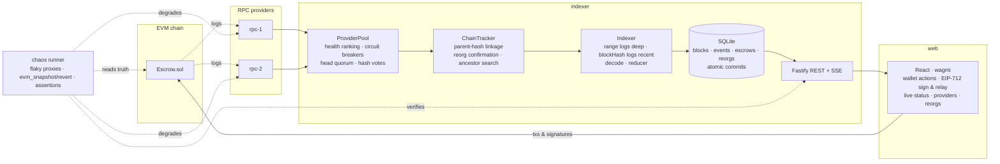

# Reorg-Safe Escrow

**A conditional-payment escrow contract with gasless EIP-712 release, indexed by a reorg-aware, multi-provider-resilient event indexer, with a React/wagmi dashboard — and a chaos runner that proves it.**


```
▶ forced reorg (evm_snapshot / evm_revert)
  ✔ doomed branch indexed before revert
  ✔ evm_revert accepted  back to block 10
  WARN reorg handled {"depth":2,"commonAncestor":"10","oldTip":"12","newTip":"13","eventsRolledBack":2,"escrowsRebuilt":2,"newEvents":3}
  ✔ reorg detected exactly once  reorgCount=1
  ✔ escrow #2 matches chain  Resolved      ← was "Released" on the orphaned branch
  ✔ escrow #4 matches chain  payee 0x15d3… ← was a different payee on the orphaned branch
  ✔ orphaned branch state is gone
▶ provider failover (rpc-1 down)
  ✔ rpc-1 circuit opened  state=open failures=2
  ✔ rpc-2 healthy and ranked first
  ✔ no false reorg during failover
  ✔ rpc-1 recovered after half-open probe
▶ total outage
  ✔ indexer survives with error surfaced
  ✔ error cleared after recovery
all 30 checks passed
```
*(excerpt of `npm run chaos` output)*

---

## What's in the box

| Package | What it is | Stack |
|---|---|---|
| [`packages/contracts`](packages/contracts) | `Escrow.sol`: ETH/ERC-20 escrow with payer/payee/arbiter, **EIP-712 gasless release** (EOA + ERC-1271), pull-payment settlement, pausable entry paths, non-pausable exits. 35 Solidity tests incl. fuzz + 1 viem interop test. | Solidity 0.8.28, Hardhat 3, forge-std, OpenZeppelin 5, viem |
| [`packages/indexer`](packages/indexer) | **Reorg-safe indexer**: health-ranked RPC pool with circuit breakers, hash-quorum reorg confirmation, EIP-234 `blockHash` log fetching in the unfinalized window, atomic per-block SQLite commits, rollback-and-replay projection, finality floor, REST + SSE API. 33 unit/integration tests. | Node ≥ 22.5 (`node:sqlite`), TypeScript, viem, Fastify, zod, vitest |
| [`packages/web`](packages/web) | Dashboard: connect wallet (MetaMask / injected, WalletConnect optional), create/release/refund/resolve/withdraw, **sign a gasless release and relay it**, live indexer status, provider health and reorg log over SSE. | React 19, wagmi 3, viem, TanStack Query, Vite 8 |
| [`packages/chaos`](packages/chaos) | End-to-end chaos runner: degradable JSON-RPC proxies (down / error rate / latency), forced reorgs via `evm_snapshot`/`evm_revert`, 30 assertions comparing indexer state with on-chain state. Exit code is the verdict. | TypeScript, viem |
| [`packages/shared`](packages/shared) | Generated `as const` ABIs, EIP-712 typed-data helpers, API DTOs. | TypeScript |

---

## Quick start

Requirements: **Node ≥ 22.5** (the indexer uses the built-in `node:sqlite`; developed on Node 26) and npm. No Foundry, Docker or native build tools needed.

```bash
npm install
npm run build:contracts      # compile + export ABIs into packages/shared
npm test                     # Hardhat (Solidity + node:test) and vitest suites
npm run chaos                # the full scenario above (~1 min). Spawns its own Hardhat node.
```

### Run the whole thing interactively

```bash
# 1. local chain (chainId 31337, http://127.0.0.1:8545)
npm run node

# 2. deploy — note the printed Escrow address
npm run -w @reorg-safe/contracts deploy:local

# 3. (optional) two degradable RPC proxies in front of the node, with control endpoints
npm run -w @reorg-safe/chaos proxy          # http://127.0.0.1:8601 and :8602
#    curl "http://127.0.0.1:8601/__chaos?down=1"           # kill rpc-1
#    curl "http://127.0.0.1:8601/__chaos?down=0&latencyMs=300"

# 4. indexer (copy packages/indexer/.env.example to .env, set CONTRACT_ADDRESS)
cd packages/indexer && cp .env.example .env && npm run dev   # API on http://127.0.0.1:4000

# 5. dashboard (copy packages/web/.env.example to .env, set VITE_ESCROW_ADDRESS)
cd packages/web && cp .env.example .env && npm run dev        # http://localhost:5173
```

In MetaMask add a network `http://127.0.0.1:8545`, chain id `31337`, and import one of Hardhat's dev keys (e.g. `0xac09…ff80`) to get funded test accounts. To force a reorg while watching the UI:

```bash
# from any shell
curl -s -X POST http://127.0.0.1:8545 -H 'content-type: application/json' -d '{"jsonrpc":"2.0","id":1,"method":"evm_snapshot","params":[]}'
#  ...create/release escrows in the UI, then revert with the returned id...
curl -s -X POST http://127.0.0.1:8545 -H 'content-type: application/json' -d '{"jsonrpc":"2.0","id":1,"method":"evm_revert","params":["0x1"]}'
#  ...send any transaction: the indexer detects the divergence, rolls back and replays.
```

---

## The problem, and how it's solved

### 1. Reorgs corrupt naive indexers

A typical indexer polls `eth_blockNumber`, pulls logs for new ranges and appends them. When the chain reorganises, events from orphaned blocks stay in the database and events in the replacement blocks may be missed. Projections drift away from the chain, silently.

**Here:** the indexer maintains a parent-hash-linked header window and never appends a block whose `parentHash` does not match the local tip ([`ChainTracker`](packages/indexer/src/chain/ChainTracker.ts)). A mismatch, or the head moving backwards, is a *suspicion* that is confirmed by asking a quorum of providers for the canonical hash at our tip. On confirmation it walks back to the common ancestor, and the indexer performs **one SQLite transaction** that deletes orphaned events and headers, rebuilds every affected escrow by **replaying its remaining events through a pure reducer**, appends the replacement blocks with their events, and records the reorg ([`Database.commitReorg`](packages/indexer/src/db/Database.ts)). Readers never see a half-applied state.

### 2. RPC providers lie, lag and fail

Public RPC endpoints behind load balancers routinely serve stale heads, sit on short-lived forks, or return 5xx. A single-provider indexer either stalls or, worse, ingests a fork and later "detects a reorg" that never happened on the canonical chain.

**Here** ([`ProviderPool`](packages/indexer/src/rpc/ProviderPool.ts)):
- every call is routed by a health score (latency EWMA, consecutive failures, circuit state) and fails over to the next provider; results carry the URL that produced them, so inconsistent data is attributed and penalised;
- a per-provider **circuit breaker** opens after N consecutive failures with exponential back-off and probes on half-open;
- `eth_blockNumber` is fanned out to a **quorum**; providers trailing the best head are flagged *lagging* and demoted so they cannot trigger false reorg suspicions;
- canonical-hash votes require a **strict majority**; with no consensus the indexer waits rather than acts.

### 3. Logs from a forked provider are indistinguishable from real ones — unless you ask by hash

Even with verified headers, `eth_getLogs(fromBlock, toBlock)` answered by a provider on another fork returns plausible logs with the wrong `blockHash`, or **silently omits** events (nothing to compare). A hash check on returned logs catches the first case but not the second.

**Here:** for blocks inside the reorg-risk window (`head - CONFIRMATIONS`), logs are fetched **per block by `blockHash`** (EIP-234). A provider that does not know the hash errors out, the pool fails over, and the events come from a provider that does know the block. Deeper blocks use cheap range queries, and every returned log's `blockHash` must match the tracked header ([`Indexer.fetchVerifiedEvents`](packages/indexer/src/indexer/Indexer.ts)). The vitest suite contains the exact scenario: a provider serving canonical headers but forked logs.

### 4. Finality is a contract, not a hope

**Here:** blocks `CONFIRMATIONS` behind the head are marked final and the header window below them is pruned. A reorg that would reach below the finalized block raises `FinalityViolationError` and **halts the indexer** (API stays up for inspection) rather than rewriting data consumers may have acted upon. The same strictness applies to the projection: an event sequence the state machine does not allow (e.g. `Released` for an unknown escrow because `START_BLOCK` is wrong) is a loud `ProjectionError`, never a silently skipped row.

### 5. The contract side: gasless, safe exits, no push payments

[`Escrow.sol`](packages/contracts/contracts/Escrow.sol) is deliberately compact but production-shaped:
- **EIP-712 `releaseWithSig`**: payer signs `Release(escrowId, nonce, deadline)`; anyone relays. Domain-bound (chain id + contract), sequential per-payer nonces, deadline, ERC-1271 support via `SignatureChecker`. The viem test proves the browser-side typed data hashes to the on-chain digest.
- **Pull payments**: state transitions only credit a ledger; `withdraw` is the single external-transfer path, `nonReentrant`, and zeroes the balance before transferring. Reentrancy and rejecting receivers are tested.
- **Pause blocks entry, never exit**: `create/release/resolve` are pausable; `refund` and `withdraw` are not, so the owner can never trap funds.
- **Fee-on-transfer safe**: ERC-20 deposits record the balance delta actually received.
- Custom errors, packed struct (5 slots), `Ownable2Step`, events designed for indexing.

Full write-ups: [docs/ARCHITECTURE.md](docs/ARCHITECTURE.md) and [docs/SECURITY.md](docs/SECURITY.md).

---

## Architecture



Sync loop, per tick: `plan = tracker.plan(localView)` → `idle | extend | reorg` → fetch verified events → `db.commitExtend` / `db.commitReorg` (one transaction) → finalize → emit SSE.

---

## Testing

| Layer | Tool | What is covered |
|---|---|---|
| Solidity | Hardhat 3 Solidity tests (forge-std) | Lifecycle, every revert path, EIP-712 digest equivalence, replay/expiry/wrong-signer/stale-nonce/cross-deployment rejection, ERC-1271 wallet, reentrancy attacker, rejecting receiver, pause semantics, fee-on-transfer, 4 fuzz suites (value conservation, signature tuple binding, deadline boundary) |
| Contract ↔ client | `node:test` + viem | Browser-style `signTypedData` payload accepted by `releaseWithSig` when relayed by a third party; replay rejected |
| Indexer units | vitest | ProviderPool failover, circuit open/half-open/close with exponential back-off, lagging detection, strict-majority hash votes; ChainTracker cold start, extend, parent-mismatch reorg, head-shrink reorg, lagging-provider idle, divergent-provider penalisation, no-consensus idle, finality violation, mid-batch truncation; reducer transitions and invariants; SQLite atomicity, rollback+replay, finalize/prune |
| Indexer end-to-end | vitest + fake chain | Index → reorg → rebuilt projection; finality bookkeeping; forked-logs provider retried elsewhere; fatal halt below finality; survive total outage |
| System | chaos runner | 30 live assertions against a real Hardhat node through degradable proxies (see top) |

```bash
npm test                               # everything
npm run -w @reorg-safe/contracts test  # contracts only
npm run -w @reorg-safe/indexer test    # indexer only
npm run typecheck                      # strict TS across all workspaces
```

---

## Design decisions & trade-offs

- **Own provider pool instead of viem's `fallback()` transport.** viem's fallback is opaque: callers cannot learn which endpoint answered, cannot vote across endpoints, and cannot penalise data that is *valid JSON-RPC but wrong*. Attribution and quorum are the whole point here.
- **Polling, not websockets.** Polling with hash-linked headers is simpler to reason about and reorg-safe by construction; `newHeads` subscriptions add a second, racy source of truth. A websocket head *hint* would be an easy latency optimisation later.
- **`CONFIRMATIONS` instead of the `finalized` tag.** Works on every chain and devnet; on PoS mainnet you would additionally pin the floor to `eth_getBlockByNumber("finalized")`. The floor logic is a single function.
- **SQLite via `node:sqlite`.** Zero native dependencies, real transactions, trivially swappable for Postgres: the store is one class with a small interface.
- **Per-block `blockHash` log queries near the head.** Costs `CONFIRMATIONS` extra requests per tick in exchange for making forked providers unable to omit or mis-attribute events. Deep history uses range queries.
- **Rebuild affected escrows by replay rather than storing undo logs.** The reducer is pure and events are the source of truth, so replay is both simpler and provably consistent; cost is proportional to the escrows touched by the reorg, not to the database.
- **Fail loud on integrity violations.** A halted indexer with a clear error beats a running one serving wrong balances.

### What I would do next for production
Pin finality to the `finalized` tag where available · websocket head hints · Postgres + migrations · Prometheus metrics on the existing health model · a relayer service for signed releases (with fee/permit handling) · multi-contract / factory indexing · deploy to Sepolia with Ignition and verify.

---

## Repository layout

```
packages/
  contracts/   Hardhat 3 project: Escrow.sol, mocks, Solidity + viem tests, Ignition module, ABI export
  shared/      generated ABIs (as const), EIP-712 helpers, API DTOs
  indexer/     src/rpc (pool, viem client), src/chain (tracker), src/db, src/indexer (decode, reducer, loop), src/api
  web/         Vite + React + wagmi dashboard
  chaos/       flaky-proxy.ts, run.ts (end-to-end scenario)
docs/          ARCHITECTURE.md, SECURITY.md
.github/       CI: build, test, typecheck, chaos
```

License: MIT.
